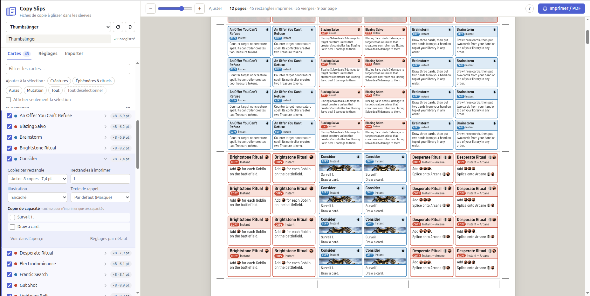

# Copy Slips

**Print-and-sleeve cheat sheets for all the copies your Magic deck makes.**

## Why?

Some decks just love copying stuff. I've got two of them. One copies mutated
creatures and auras stuck on creatures. The other copies instants, sorceries and
abilities, and messes with the stack a lot: copy this, counter that, bounce the
other thing back to hand…

In thoses edge cases, generic copy tokens don't cut it, at least for me. They don't tell you *what* got copied, or which
abilities a copy of a five-card mutate pile actually has. In my experience, a few turns in, and nobody at
the table knows what's going on anymore.

Copy Slips tries to help in that regard. The idea is to slip a few miniature copies of each card you may copy directly in their sleeves, in small text-only versions of that card: name, cost, type line with a **COPY
TOKEN** tag, and rules text. The slip lives in the card's sleeve, right behind it.
When the card gets copied, the exact copy is already at hand.

## What it does

- Imports your deck from an **Archidekt** link or a plain **text list** (Moxfield,
  MTG Arena, MTGO exports all work).
- Prints the card text in **English (Oracle)** or **French**, with full-color mana
  symbols.
- Fits as many copies as possible on each slip without going below a minimum font
  size you choose.
- Lets you tweak each card:
  - how many copies per slip;
  - which face of a double-faced card;
  - **ability copies**, to print just the abilities you pick;
  - card art, in one of four styles, always credited to the artist.
- Labels each mini **Copy token**, **Copy** or **Ability copy**, depending on what
  got copied.
- Adds **blank slips** for the cards you don't copy, so nobody can tell your cards
  apart by touch.
- Shows a **live preview** that matches the printout exactly. You export to PDF
  straight from your browser, with crop marks, 9 slips per A4 page.
- Saves each deck and its settings automatically.

> **Heads-up:** the interface is in French for now. The cards themselves can be
> printed in English.

## Getting started

All you need is **Python 3.9 or newer**. There's nothing else to install: no pip,
no npm, no build step.

1. Grab the project: **Code → Download ZIP** on GitHub (then unzip it), or `git clone` it.
2. Launch it:
   - **Windows**: double-click `lancer.bat`;
   - **Linux / macOS**: run `./lancer.sh` (or `python3 app.py`).
3. Your browser opens on `http://127.0.0.1:8765/`. Keep the terminal window open
   while you use the tool, and close it when you're done.

You need an internet connection to fetch the cards. They're cached afterwards.

I use it on Linux (Ubuntu). Windows and macOS should work too. If they don't,
please open an issue!

## How to use it

The tool has three tabs: **Cartes** (cards), **Réglages** (settings) and
**Importer** (import).

1. **Import a deck** in the *Importer* tab. Paste an Archidekt link (the deck must
   be public or unlisted) or a text list. Sideboard and maybeboard are skipped.
2. **Pick the cards you copy** in the *Cartes* tab by ticking them. The shortcut
   buttons add whole groups at once: creatures (*Créatures*), instants & sorceries
   (*Éphémères & rituels*), *Auras* and mutate cards (*Mutation*).
3. **Tweak a card** by clicking it:
   - **copies per slip**: *Auto* fits as many as it can. The dropdown shows the font
     size you'd get for each count;
   - **number of slips**: the deck quantity by default;
   - **face**: one face or all of them, for double-faced, split and adventure cards;
   - **art style**: art box, title banner, frame around the text, or faded background;
   - **ability copy**: tick one or more abilities to print only those.
4. **Adjust the settings** in the *Réglages* tab: language, font, min/max font
   size, reminder text, slip size, blank slips, paper size.
5. **Print** with the **Imprimer / PDF** button.

Everything saves automatically, per deck. Changed your deck on Archidekt? The ↻
button reloads it and keeps your settings. Click any slip in the preview to jump
to that card.

### Blank slips

A slip makes a card feel slightly different in its sleeve. To keep things fair,
Copy Slips adds one blank slip for each card in the deck that doesn't get a printed
slip. Put them behind every other card and your whole deck feels the same. You can
also print a fixed number of blanks, or just fill up the last page.

## Printing and cutting

What you see in the preview is exactly what gets printed. Hit **Imprimer / PDF**,
then in the print dialog:

- use a Chromium-based browser if you can (Chrome, Edge, Brave, Chromium…);
- pick "Save as PDF" or your printer;
- set the scale to **100% / actual size**, never "fit to page";
- leave margins on "None" or "Default".

Print a test page first and check that a slip is 63 × 88 mm (the default size).
Slips touch each other, so one cut separates two neighbors. Follow the crop marks
in the margins with a paper trimmer, or a craft knife and a ruler. The dotted lines
inside a slip separate the minis.

Thin paper (80 gsm) slides into a sleeve more easily when there's already a card in it.

## This is not a proxy tool

The minis are text only, labeled as copies, and they sit behind the real card. You
need to own the card to use them. Think of them as fancy tokens, not proxies.

Copy Slips is made for casual games with friends. Taking it to a tournament? Ask
the organizer first: extra stuff in your sleeves might not fly.

## Privacy

Everything runs on your computer. The local server only talks to Archidekt (to
read your deck) and Scryfall (card data and images). It follows Scryfall's API
rules: it identifies itself, sends at most 10 requests per second, and caches
everything locally.

Your decks and the cache live in the `data/` folder, which is not tracked by git.
You can delete `data/cache/` anytime: it rebuilds itself.

## Project structure

| File | What it does |
| --- | --- |
| `app.py` | Local server: Archidekt and Scryfall relay, cache, deck saving. Python standard library only |
| `web/index.html`, `web/css/` | The interface and the printable sheets |
| `web/js/main.js` | App state, card list, settings, import, printing |
| `web/js/mini.js` | Builds one mini: text, mana symbols, colors, art |
| `web/js/fit.js` | Picks the grid and the biggest font size that fits |
| `web/js/pages.js` | Lays slips out on pages, draws crop marks |
| `web/js/parse.js` | Reads text deck lists |

There's no build step: edit a file, reload the page.

## Credits and legal stuff

- Card data, images and mana symbols come from [Scryfall](https://scryfall.com).
  Copy Slips is not affiliated with or endorsed by Scryfall.
- Card art shown on the minis is credited to its artist.
- Fonts: Barlow Semi Condensed and Crimson Pro, under the SIL Open Font License
  (see `web/fonts/`).

Required by Wizards of the Coast's [Fan Content Policy](https://company.wizards.com/en/legal/fancontentpolicy):

> Copy Slips is unofficial Fan Content permitted under the Fan Content Policy. Not
> approved/endorsed by Wizards. Portions of the materials used are property of Wizards
> of the Coast. ©Wizards of the Coast LLC.
